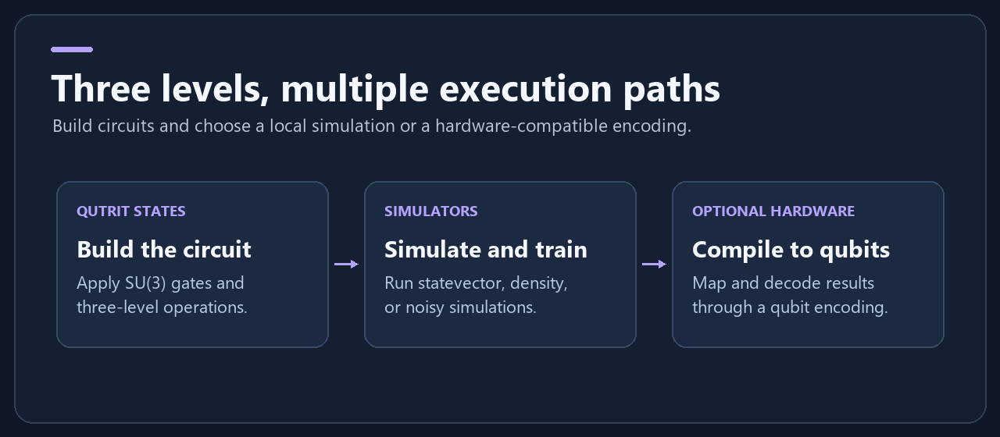

# TriFlowQC

A Python framework for simulating, training, and compiling three-level quantum circuits.

**Tech stack** · Python · NumPy · SciPy · Qiskit · pytest



## What you can build

- Three-level quantum circuits with single- and multi-qutrit gates.
- Statevector, density-matrix, and noisy simulations.
- Trainable models with a Keras-style `Sequential` interface and variational optimizers.
- Optional Qiskit compilation and IBM Quantum execution through a qutrit-to-qubit encoding.

## Quick start

```bash
python -m pip install -e .
```

```python
from triflowqc.circuit.circuit import QutritCircuit
from triflowqc.simulator.statevector_sim import StatevectorSimulator

circuit = QutritCircuit(1).h3(0)
result = StatevectorSimulator().run(circuit)
print(result.probabilities.round(3))  # [0.333 0.333 0.333]
```

Explore the [examples](examples/) or [notebooks](notebooks/). The [API and math guide](API_GUIDE.md) covers circuit construction, training, encoding, and hardware setup. Install the `ibm` extra only for the IBM Quantum path.

## Tests and verification

```bash
python -m pip install -e ".[dev]"
python -m pytest tests/unit tests/math_validation tests/integration
```

This snapshot’s unit, math, and integration run returned 200 passes and 13 failures. The failures cover parts of circuit handling, noise, compilation, and training. Some older examples also use earlier API signatures.

The [test suite](tests/) covers gates, circuits, measurement, noise, training, and algebra. Hardware tests are separate and require IBM Quantum access. The project includes numerical [validation scripts](validation/).

## License

The project code is available under the [MIT License](LICENSE).
